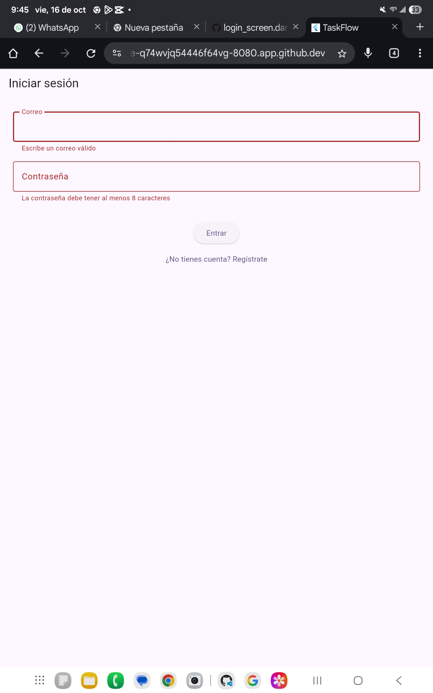
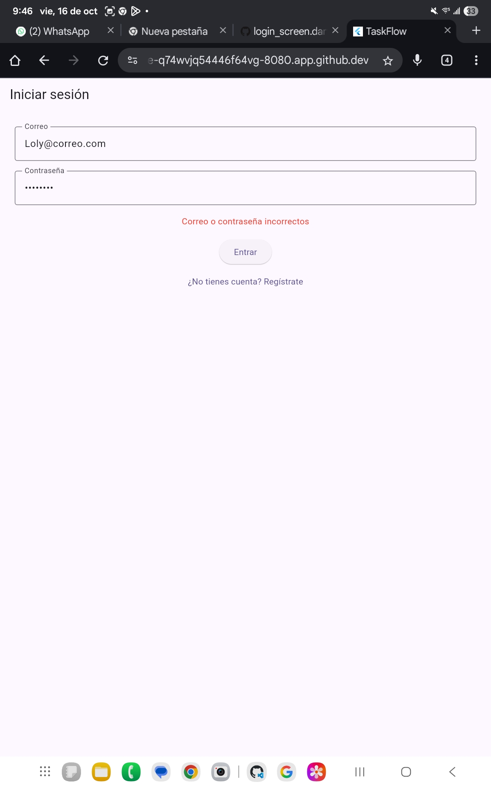
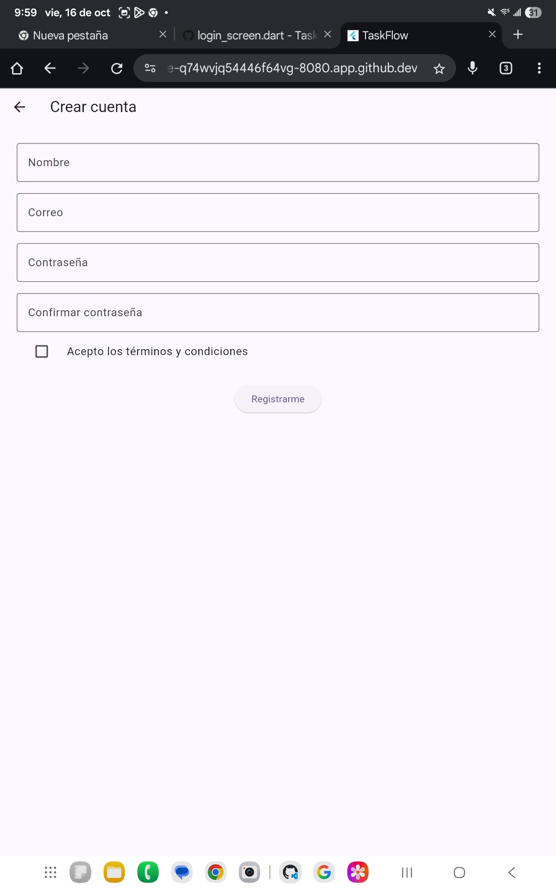
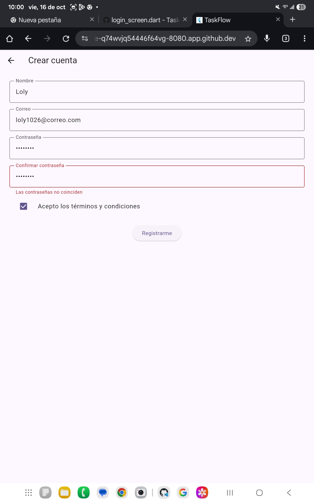
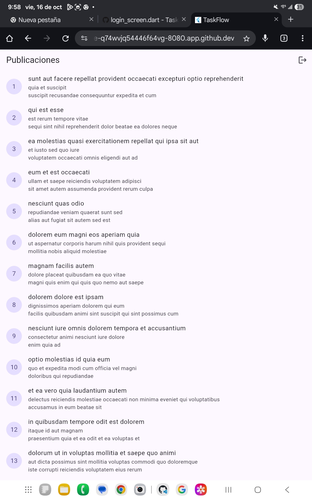
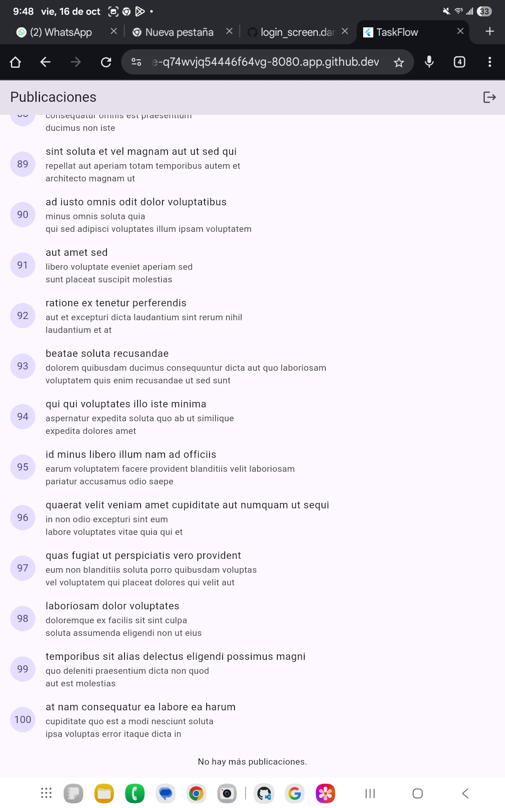
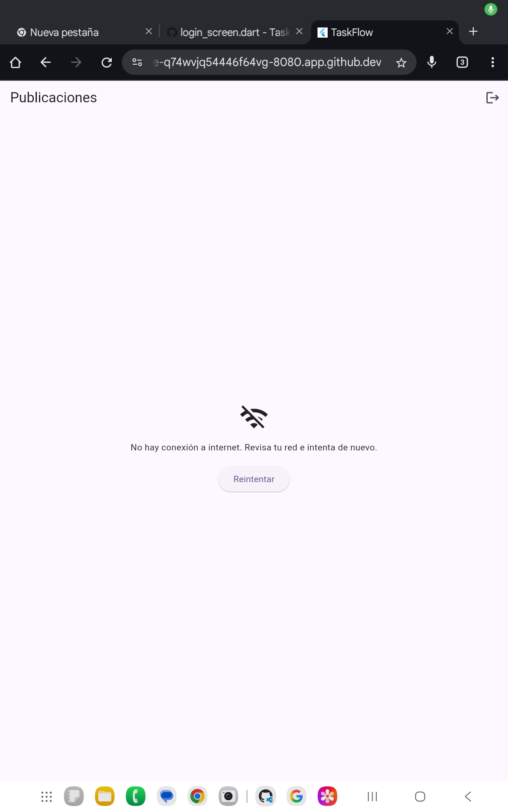
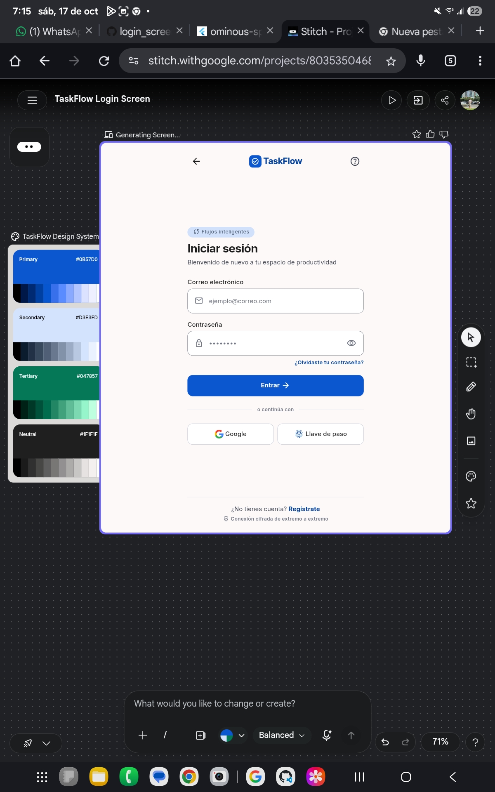
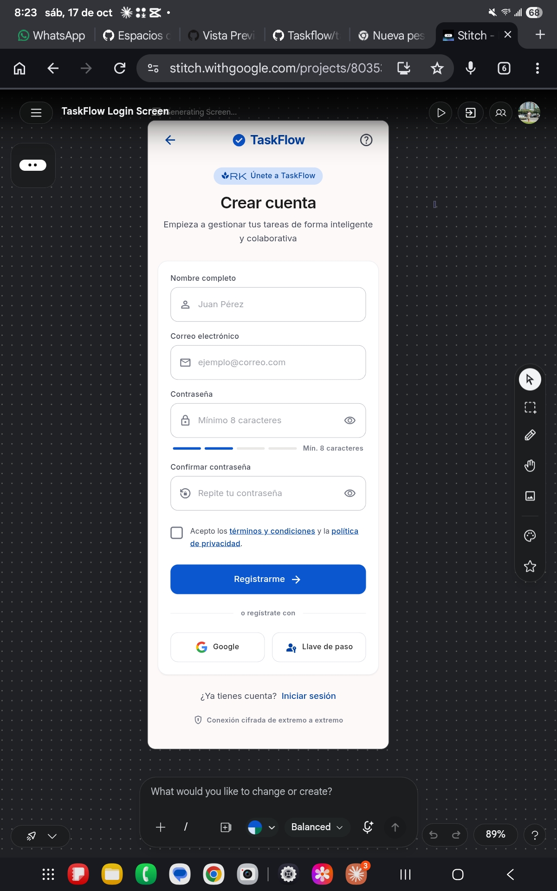
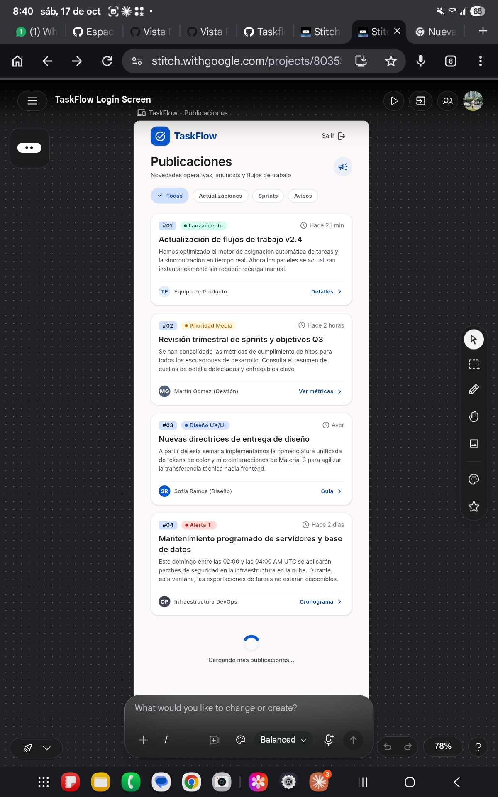

# TaskFlow – Acceso y listado (Parcial 2)

App Flutter con Login, Registro y Listado de publicaciones.
Carpeta de la app: `taskflow_s14_base`

## Diseños en Google Stitch
Proyecto: https://stitch.withgoogle.com/projects/8035350468553578398

Prompt usado para el Login:
"Diseña la pantalla de Login de una app móvil llamada TaskFlow. Tiene el título "Iniciar sesión", un campo de correo, un campo de contraseña, un botón principal "Entrar" y un enlace "¿No tienes cuenta? Regístrate". Estilo limpio y moderno, Material 3, colores azul y blanco, todo en español."

Se pidieron también el Registro ("Crear cuenta") y el Listado ("Publicaciones") con el mismo estilo.

## Diferencias entre el diseño y mi app
1. Stitch agregó botones de Google y Llave de paso. No los implementé porque el enunciado solo pide correo y contraseña, y el inicio de sesión es simulado.
2. Stitch agregó filtros, etiquetas y autor en el Listado. No los implementé porque la API de prueba solo entrega título y texto.
3. Stitch agregó un medidor de seguridad de contraseña en el Registro. Mi app solo valida el mínimo de 8 caracteres.

## Cómo ejecutar
1. `cd taskflow_s14_base`
2. `flutter pub get`
3. `flutter run -d web-server --web-port 8080`
4. Contraseña de prueba del Login: `12345678`

## Declaración de uso de IA
- Los diseños de las 3 pantallas se generaron con Google Stitch (IA).
- Parte del código de la app (login, registro, campo reutilizable, servicio HTTP, provider y listado) se generó con ayuda de Claude (IA).
- Acepté la paleta de colores propuesta.
- Modifiqué partes del diseño y la forma del código.
- Probé la app funcionando: validación del Login y del Registro, scroll infinito, error sin conexión con "Reintentar" y navegación sin volver al Login.

## Capturas de la app

### Login

Validación del Login: correo inválido y contraseña de menos de 8 caracteres.

Mensaje «Correo o contraseña incorrectos».

### Registro

Pantalla de Registro.

Validación cruzada: «Las contraseñas no coinciden».

### Listado

Primera carga: publicaciones 1 a 13.

Fin del scroll infinito: «No hay más publicaciones.»

Error sin conexión con el botón Reintentar.

### Diseño en Stitch

*Diseño de Stitch: pantalla de Registro (Crear cuenta).*

*Diseño de Stitch: pantalla de Listado (Publicaciones).*

